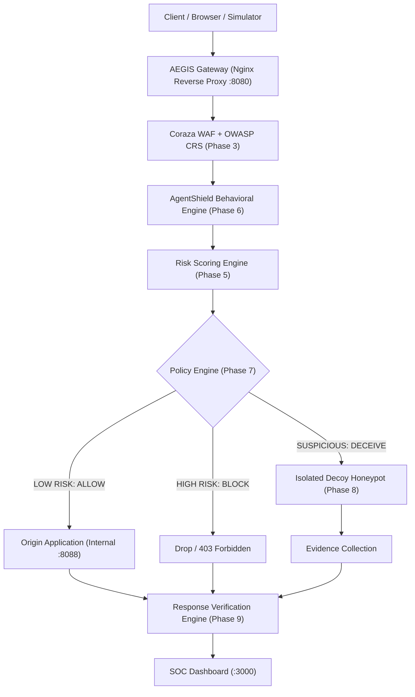

# AEGIS Ω — AI Adaptive Web Defense & Deception Platform

[](.)
[](.)
[](.)
[](.)
[](.)
[](LICENSE)
[](docker-compose.yml)

> **Detect. Predict. Deceive. Contain.**

AEGIS Ω is an adaptive, application-layer cyber defense platform that integrates an Ingress Reverse Proxy Gateway, Web Application Firewall (WAF), AgentShield behavioral heuristics, an Isolated Decoy Honeypot, and Provable Response Verification into an enterprise SOC dashboard.

---

## 1. Quick Start

### Prerequisites
- [Docker](https://www.docker.com/) & Docker Compose v2+
- Python 3.12+ (for running test harnesses)

### Launching AEGIS Ω
```bash
# 1. Clone & enter repository
git clone <repo-url>
cd "Cyber defence system"

# 2. Configure environment variables
cp .env.example .env

# 3. Start all containers via Docker Compose
docker compose up -d --build

# 4. Check status of all containers
docker compose ps
```

### Accessing Services
| Service | URL / Port | Role | Accessibility |
|---|---|---|---|
| **AEGIS Gateway Ingress** | `http://localhost:8080/` | Main entrypoint for all web traffic | **Public / Host** |
| **Gateway Health Probe** | `http://localhost:8080/healthz` | Native ingress health probe | **Public / Host** |
| **Gateway API Route** | `http://localhost:8080/api/v1/health` | Proxied API route via Gateway | **Public / Host** |
| **SOC Defense Dashboard** | `http://localhost:3000/` | Cyber Command SOC console | **Public / Host** |
| **Control Plane API** | `http://localhost:8001/` | REST API & System Telemetry | **Host (Dev Only)** |
| **PostgreSQL Database** | `localhost:5433` (Internal: `db:5432`) | State & Event Store | **Host (Dev Only)** |
| **Protected Origin** | `origin:8088` | Upstream protected application | **Internal Only (`aegis-net`)** |

---

## 2. Architecture & Pipeline



---

## 3. Phase 2: Gateway Hardening & Request Tracing

Phase 2 establishes a hardened, observable ingress layer:
1. **Request ID Validation & Normalization**:
   - Every request is assigned a unique `X-Request-ID`.
   - Client-provided IDs are validated via regex `^[a-zA-Z0-9_\-]{8,64}$`. Malformed IDs (such as XSS or path traversal attempts) are rejected and replaced by a fresh 32-character hexadecimal UUID.
2. **Trace ID Chain Linkage**:
   - `X-Trace-ID` links requests belonging to the same workflow or multi-step execution.
3. **Structured JSON Access Logging**:
   - Gateway logs strictly in JSON (`timestamp`, `request_id`, `trace_id`, `method`, `uri`, `status`, `request_time`, `upstream_response_time`, etc.).
   - Prevents credential leakage by logging normalized paths rather than raw query strings with sensitive secrets.
4. **Defensive Security Headers**:
   - `X-Content-Type-Options: nosniff`
   - `X-Frame-Options: SAMEORIGIN`
   - `Referrer-Policy: strict-origin-when-cross-origin`
   - `Permissions-Policy: geolocation=(), camera=(), microphone=()`
   - `Content-Security-Policy: default-src 'self' ...`
   - `X-Protected-By: AEGIS-Omega-Gateway`
5. **Request Limits & Controlled Errors**:
   - Client body size limit enforced at 10MB (payload > 10MB returns clean HTTP 413 JSON).
   - Unsupported HTTP verbs return controlled HTTP 405 Method Not Allowed JSON responses.
   - Upstream failures (502/503/504) return structured JSON errors rather than raw Docker stack traces.

### Running Automated Tests
```bash
# Run all Phase 1-5 integration and unit tests (52 tests)
pytest tests/ -v
```

---

## 4. Phase 3: Real Web Application Firewall (Coraza + OWASP CRS)

Phase 3 integrates an industrial-grade Web Application Firewall inspecting application-layer payloads before traffic ever reaches the origin:
1. **Coraza + CRS Engine**:
   - OWASP Coraza WAF v3.2.2 on Caddy v2.11.4 (`ghcr.io/coreruleset/coraza-crs:caddy-alpine`).
   - OWASP Core Rule Set (CRS) v4.30.0 providing deterministic threat signatures for SQLi, XSS, Path Traversal, and RCE.
2. **Defensive Traffic Flow**:
   ```
   Client ──> AEGIS Gateway (:8080) ──> Coraza WAF (Caddy) ──> OWASP CRS ──> Origin (:8088)
   ```
3. **Attack Detection & Interception**:
   - When CRS rules match malicious input, Coraza blocks with HTTP 403 Forbidden.
   - Nginx intercepts the 403 via `proxy_intercept_errors` and returns a non-leaking, secure JSON error:
     ```json
     {
       "error": "request_blocked",
       "status": 403,
       "message": "Request blocked by AEGIS Web Application Firewall",
       "request_id": "019a2b3c4d5e6f7a8b9c0d1e2f3a4b5c",
       "trace_id": "019a2b3c4d5e6f7a8b9c0d1e2f3a4b5c"
     }
     ```
   - **Origin Isolation**: Verified by in-memory origin telemetry; blocked requests are completely stopped before reaching the upstream application.
4. **Real-Time Telemetry Watcher**:
   - Coraza writes structured JSON audit logs to `/var/log/coraza/audit.log`.
   - FastAPI asynchronous background watcher (`waf_log_watcher.py`) tails this log in real time and ingests events into PostgreSQL (`waf_events` table).
   - SOC Dashboard exposes real-time operational status and metrics.

---

## 5. Phase 4: Security Event Pipeline & Real-Time Telemetry

Phase 4 establishes an enterprise security telemetry and correlation pipeline connecting Gateway, WAF, and Origin directly to the SOC Dashboard:
1. **Pipeline Architecture**:
   ```
   Client ──> AEGIS Gateway ──> Coraza WAF ──> Security Event Pipeline ──> PostgreSQL ──> WebSocket ──> SOC Dashboard
   ```
2. **Unified Event Model**:
   - Standardized typed JSON envelope (`models/events.py`) covering `event_id`, `event_type`, `timestamp`, `request_id`, `trace_id`, `severity`, `action`, `component`, `status`, and `metadata`.
   - Clear event taxonomy: `GATEWAY_REQUEST`, `WAF_DETECTION`, `WAF_BLOCK`, `ORIGIN_REQUEST`, `SYSTEM_EVENT`.
3. **Deduplication & Correlation**:
   - Deterministic hashing signatures prevent duplicate event creation when log watchers restart.
   - `request_id` links multi-component actions for individual transactions; `trace_id` links multi-request workflows.
4. **Real-Time Streaming**:
   - WebSocket broadcast (`/api/v1/ws/events`) streams live alerts to the SOC Dashboard with zero page reloads.
   - Live event investigation modal enables operators to inspect CRS rule matches, anomaly scores, and verify origin protection.
5. **Data Protection & Sanitization**:
   - Automated recursive sanitization redacts sensitive credentials, tokens, authorization headers, and secret URL query parameters.

---

## 6. Phase 5: Explainable Risk Engine

Phase 5 introduces a deterministic, explainable Threat Scoring Engine that converts raw security events into transparent, auditable risk evaluations:
1. **Mathematical Scoring Architecture**:
   - Scores bounded strictly from `0` to `100`.
   - **Deterministic & Reproducible**: Given the same telemetry and context, the engine generates the identical score every time. Zero random numbers or arbitrary "black-box" outputs.
2. **Transparent Severity Thresholds**:
   - `0 - 24`: **LOW**
   - `25 - 49`: **MEDIUM**
   - `50 - 74`: **HIGH**
   - `75 - 100`: **CRITICAL**
3. **Decomposed Risk Signals**:
   - `waf_severity`: CRITICAL (+30), HIGH (+20), MEDIUM (+10), LOW (+5)
   - `known_attack_rule`: +20 for CRS rule IDs in ranges 942xxx (SQLi), 941xxx (XSS), 930xxx (LFI), 932xxx (RCE)
   - `elevated_anomaly_score`: +10 if CRS anomaly score >= 5
   - `endpoint_sensitivity`: HIGH (+20 for `/admin`, `/.env`), MEDIUM (+10 for `/login`), LOW (+0)
   - `repeated_activity`: 2-3 events (+10), 4+ events (+20) in 60s
   - `request_velocity`: >= 5 events in 60s (+15)
   - `endpoint_probing`: >= 3 distinct paths probed (+10)
4. **Temporal Context & Correlation**:
   - Evaluates threat escalation across a rolling 60-second temporal window linked by `trace_id` / `session_id`.
5. **Persistence & Real-Time SOC Telemetry**:
   - Stored in PostgreSQL `risk_assessments` table with compound indexing.
   - Multicasts real-time `RISK_SCORE_UPDATE` packets via WebSockets to the SOC Dashboard's interactive Risk Gauge & Signals Breakdown panel.
6. **Failure Safety Guarantee**:
   - Engine failures or missing telemetry are isolated: WAF blocking and event ingestion proceed without interruption.

---

## 7. Phase-by-Phase Roadmap

- [x] **Phase 1: Foundation** (Docker Compose, Gateway, FastAPI, PostgreSQL, Origin, Dashboard Skeleton, Tests)
- [x] **Phase 2: Gateway Hardening & Tracing** (Request ID validation, trace ID, JSON logs, security headers, limits, timeouts)
- [x] **Phase 3: Real WAF** (Coraza engine v3 + OWASP CRS v4 integration, origin isolation, telemetry ingestion)
- [x] **Phase 4: Event Pipeline** (Unified security event pipeline, deduplication, correlation, WebSocket streaming, SOC feed)
- [x] **Phase 5: Risk Engine** (Deterministic 0-100 scoring & signal weighting)
- [ ] **Phase 6: AgentShield** (Behavioral sequence analysis & agentic pattern detection)
- [ ] **Phase 7: Policy Engine** (ALLOW, BLOCK, CONTAIN + DECEIVE policies)
- [ ] **Phase 8: Adaptive Honeypot** (Synthetic decoys: `/decoy-admin`, `/decoy-api`)
- [ ] **Phase 9: Response Verification** (Origin impact validation & verification receipts)
- [ ] **Phase 10: SOC Dashboard Completion** (Threat feed, kill chain, deception panel)
- [ ] **Phase 11: AI SOC Copilot** (Evidence-based plain English incident explainer)
- [ ] **Phase 12: Demo Store** (Simulated e-commerce web app for live demonstrations)
- [ ] **Phase 13: Controlled Attack Simulator** (Safe, reproducible attack sequences)
- [ ] **Phase 14: End-to-End Verification** (Full 3-minute hackathon demo validation)
