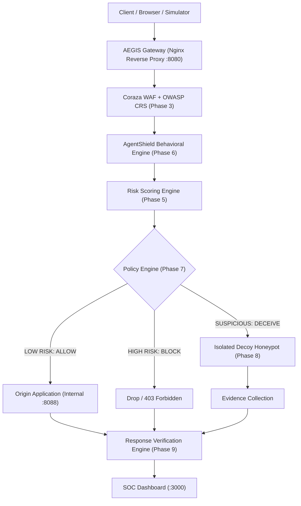

# AEGIS Ω — AI Adaptive Web Defense & Deception Platform

[](.)
[](LICENSE)
[](docker-compose.yml)

> **Detect. Predict. Deceive. Contain.**

AEGIS Ω is an adaptive, application-layer cyber defense platform that integrates an Ingress Reverse Proxy Gateway, Web Application Firewall (WAF), AgentShield behavioral heuristics, an Isolated Decoy Honeypot, and Provable Response Verification into an enterprise SOC dashboard.

---

## 1. Quick Start

### Prerequisites
- [Docker](https://www.docker.com/) & Docker Compose v2+
- Python 3.12+ (for running test harnesses)

### Launching AEGIS Ω (Phase 1)
```bash
# 1. Clone & enter repository
git clone <repo-url>
cd "Cyber defence system"

# 2. Configure environment variables
cp .env.example .env

# 3. Start all containers via Docker Compose
docker compose up -d --build

# 4. Check status of all containers
docker compose ps
```

### Accessing Services
| Service | URL / Port | Role |
|---|---|---|
| **AEGIS Gateway Ingress** | `http://localhost:8080/` | Main entrypoint for all web traffic |
| **Gateway Health Probe** | `http://localhost:8080/healthz` | Native ingress health probe |
| **Gateway API Route** | `http://localhost:8080/api/v1/health` | Proxied API route via Gateway |
| **SOC Defense Dashboard** | `http://localhost:3000/` | Cyber Command SOC console |
| **Control Plane API** | `http://localhost:8001/` | REST API & System Telemetry |
| **PostgreSQL Database** | `localhost:5433` (Internal: `db:5432`) | State & Event Store |
| **Protected Origin** | *Internal Only* (`origin:8088`) | Upstream protected application |

---

## 2. Architecture & Pipeline



---

## 3. Phase 1 Verification Proof

Phase 1 provides a fully working, reproducible foundation with:
1. **AEGIS Ingress Gateway (`gateway/nginx`)**: Reverse proxies traffic, injects unique `X-Request-ID` headers into all requests, logs structured JSON metrics.
2. **Control Plane API (`services/api`)**: FastAPI backend with active PostgreSQL connection pool, health endpoints (`/health`, `/api/v1/health`), and microservice status registry (`/api/v1/system/status`).
3. **Database (`database/`)**: PostgreSQL 16 container with initialized tables for sessions, traffic logs, WAF events, policy actions, and mitigation receipts.
4. **Temporary Origin (`services/origin`)**: Lightweight internal service proving real traffic flow from Gateway to protected backend.
5. **SOC Dashboard (`apps/dashboard`)**: Professional dark cybersecurity UI in React 18, Vite, TypeScript, and Tailwind CSS.
6. **Docker Network Isolation**: Internal `aegis-net` network prevents direct public access to database and origin.

### Running Automated Tests
```bash
# Install test requirements
pip install -r tests/requirements.txt

# Run Phase 1 integration tests
pytest tests/
```

---

## 4. Phase-by-Phase Roadmap

- [x] **Phase 1: Foundation** (Docker Compose, Gateway, FastAPI, PostgreSQL, Origin, Dashboard Skeleton, Tests)
- [ ] **Phase 2: Gateway Hardening** (JSON Access logs, rate limiting, request tracing)
- [ ] **Phase 3: Real WAF** (Coraza engine + OWASP CRS integration)
- [ ] **Phase 4: Event Pipeline** (WAF and traffic log ingestion into PostgreSQL)
- [ ] **Phase 5: Risk Engine** (Deterministic 0-100 scoring & signal weighting)
- [ ] **Phase 6: AgentShield** (Behavioral sequence analysis & agentic pattern detection)
- [ ] **Phase 7: Policy Engine** (ALLOW, BLOCK, CONTAIN + DECEIVE policies)
- [ ] **Phase 8: Adaptive Honeypot** (Synthetic decoys: `/decoy-admin`, `/decoy-api`)
- [ ] **Phase 9: Response Verification** (Origin impact validation & verification receipts)
- [ ] **Phase 10: SOC Dashboard Completion** (Threat feed, kill chain, deception panel)
- [ ] **Phase 11: AI SOC Copilot** (Evidence-based plain English incident explainer)
- [ ] **Phase 12: Demo Store** (Simulated e-commerce web app for live demonstrations)
- [ ] **Phase 13: Controlled Attack Simulator** (Safe, reproducible attack sequences)
- [ ] **Phase 14: End-to-End Verification** (Full 3-minute hackathon demo validation)
